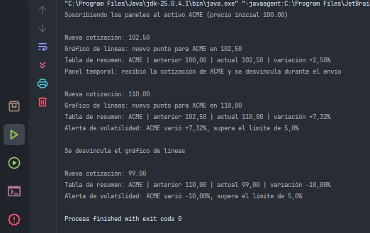

# Ejercicio 06 - Panel de Cotizaciones Bursátiles en Tiempo Real

## Descripción

Una plataforma financiera procesa el valor cambiante de las acciones y debe alimentar en tiempo real a distintos paneles de los inversores: gráficos de líneas, tablas de resumen y alertas de volatilidad.

## Objetivos

- Propagar datos numéricos frecuentes desde un punto centralizado de notificación.
- Calcular la variación porcentual respecto al precio anterior.
- Enviar a los paneles solo los datos necesarios para redibujarse.
- Gestionar la lista de suscriptores de forma segura ante modificaciones concurrentes.

## Implementación del patrón Observer

Se usa la variante push con un objeto de datos inmutable.

- **Sujeto:** `Stock` guarda el precio y, en `updatePrice`, calcula la variación y notifica.
- **Dato enviado:** `Quote` es un `record` con símbolo, precio actual, precio anterior y variación porcentual. Es liviano e inmutable.
- **Observador:** `QuoteObserver` declara `onQuoteUpdated(Quote quote)`.
- **Observadores concretos:** `LineChartPanel`, `SummaryTablePanel` y `VolatilityAlertPanel`.
- **Seguridad concurrente:** la lista es un `CopyOnWriteArrayList`. `TemporaryPanel` se desvincula a sí mismo en medio del envío y no genera errores.

## Propósito de la clase

- `Quote`: cotización inmutable que reciben los paneles.
- `QuoteObserver`: interfaz común de los paneles.
- `Stock`: activo financiero y sujeto observable.
- `LineChartPanel`: agrega un punto al gráfico por cada cotización.
- `SummaryTablePanel`: muestra precio anterior, actual y variación.
- `VolatilityAlertPanel`: avisa solo cuando la variación supera un límite.
- `TemporaryPanel`: panel que se desvincula durante la notificación.
- `Main`: simula cambios de precio y altas y bajas de paneles.

## Concepto clave

Los paneles reciben un objeto inmutable con los datos ya calculados, así que no necesitan consultar al activo ni guardar su estado. Además, el sujeto puede modificar su lista de suscriptores mientras notifica sin romper el recorrido.

## Resultado

## Conclusión

El patrón Observer permite alimentar muchos paneles con una sola actualización de precio. Con un objeto de cotización inmutable y una lista segura ante concurrencia, el sistema es eficiente, desacoplado y fácil de extender con nuevos paneles.
